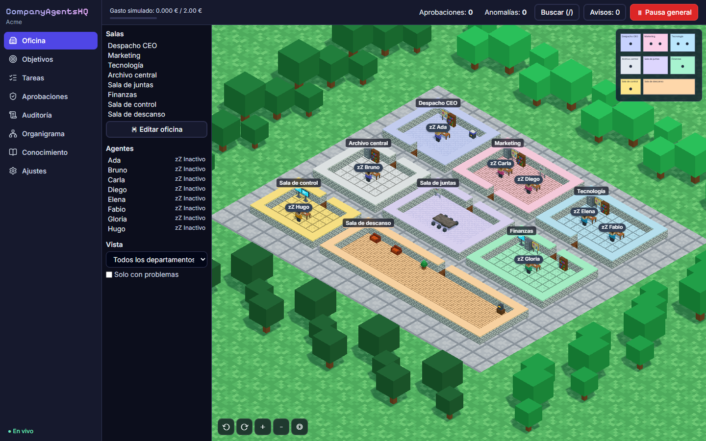

# CompanyAgentsHQ



Monta una empresa de agentes de IA con organigrama real y gestiónala desde una oficina isométrica. Das un objetivo a la CEO, apruebas su plan, los jefes revisan a su equipo y todo queda archivado, auditado y con su coste.

## Arrancar

Con Docker:

```bash
docker compose up --build
```

Abre http://localhost:8080. Sin configurar nada funciona en modo simulado, sin llamadas a ningún modelo y sin gasto.

Sin Docker (Windows, macOS o Linux, con Python 3.12 y Node 22):

```bash
cd backend
python --version                          # debe ser 3.12 o superior; si no, usa la ruta de ese Python
python -m venv .venv                      # solo la primera vez: repetirlo con otra versión rompe el entorno
.venv/Scripts/pip install -e ".[dev]"     # en macOS y Linux: .venv/bin/pip
.venv/Scripts/python scripts/devserver.py

cd frontend
npm install
npm run dev
```

Abre http://localhost:5173. PostgreSQL con pgvector se instala y arranca solo dentro de `backend/.local`.

## Coste

Por defecto no se paga nada: `LLM_PROVIDER=fake` no llama a ningún modelo y el contador indica «Gasto simulado». Con Ollama tampoco hay coste. Solo la API de Claude factura, y únicamente si pones `LLM_PROVIDER=anthropic` y una clave tuya.

## Usar Ollama (gratis y local)

1. Instala Ollama y define la variable de entorno `OLLAMA_CONTEXT_LENGTH=16384`. El contexto por defecto es corto y los agentes perderían sus instrucciones.
2. Descarga un modelo con soporte de herramientas y otro de embeddings:
   ```bash
   ollama pull qwen3.5:4b   # probado en 8 GB de VRAM: un objetivo tarda entre 5 y 12 minutos
   ollama pull bge-m3
   ```
3. Crea `.env` en la raíz del proyecto con `LLM_PROVIDER=ollama` y reinicia la API.
4. En Ajustes elige el modelo potente, el rápido y los embeddings `ollama` / `bge-m3`. Si no eliges modelo, se usa el primero instalado.

Si `ollama list` sale vacío pero ya descargaste modelos, mira la carpeta de modelos en los ajustes de la app de Ollama: el servidor solo ve la que tenga configurada.

Si Ollama está apagado, el agente se pausa con el motivo y su tarea se retoma al reanudarlo. Un modelo sin soporte de herramientas hace fallar sus tareas: los agentes dependen de ellas.

## Usar otros modelos

Copia `.env.example` a `.env` y elige proveedor:

| `LLM_PROVIDER` | Qué necesita |
|---|---|
| `fake` | Nada: respuestas guionizadas de `backend/seeds/fake_llm/script.yaml` |
| `anthropic` | `ANTHROPIC_API_KEY`. La CEO usa `claude-opus-5-5`; el resto, `claude-haiku-5-5` |
| `ollama` | Ollama en marcha. Indica los modelos en Ajustes |
| `openai_compatible` | `OPENAI_BASE_URL`: LM Studio, llama.cpp, vLLM… |

En Ajustes puedes cambiar los modelos potente y rápido, y en la ficha de cada agente fijar uno propio, por ejemplo `ollama:llama3.2`. Allí aparecen los modelos detectados en Ollama y en la caché de Hugging Face.

Los embeddings se cambian también en Ajustes: `hash` (por defecto, sin red), `ollama`, `sentence_transformers` (nombre o ruta de un modelo descargado; requiere `pip install -e ".[local-embeddings]"`) u `openai_compatible`. Al cambiar se reindexa todo. Para uso real, `bge-m3` en Ollama: `hash` solo compara palabras, no significado.

Antes de exponerlo fuera de tu equipo pon `COOKIE_SECURE=true`, sirve la app por HTTPS y cambia `POSTGRES_PASSWORD`, `S3_ACCESS_KEY` y `S3_SECRET_KEY`.

## Cargos y salas

En Organigrama puedes contratar 21 cargos directivos repartidos en seis áreas, o escribir uno libre. Cada cargo va a la sala y al departamento de su área; las salas que aún no existan se crean con la primera contratación ([ADR 0007](docs/decisiones/0007-catalogo-de-cargos-y-areas.md)).

## Oficina y empresa

- **Editar la oficina:** en Oficina, pulsa «Editar oficina» para crear, mover, redimensionar y borrar salas y colocar muebles. La app rechaza los solapes y lo que deje a un agente sin paso.
- **Gestionar:** en Organigrama, los departamentos; en la ficha de cada agente, nombre, jefe, departamento, presupuesto, herramientas, modelo, rutina y prompt; en Tareas, reasignar, priorizar, cancelar y reintentar; en Conocimiento, permisos por agente. El editor de la oficina también añade y quita muebles, coloca la puerta y restringe salas.
- **Copia de seguridad:** en Ajustes, «Exportar empresa» descarga un ZIP con configuración, historial y ficheros. Se restaura al crear la empresa en una instalación nueva. El conocimiento se reindexa y las tareas en curso quedan bloqueadas para que decidas.
- **Idioma y tema:** español o inglés y tema oscuro o claro, en Ajustes. Cambiar el idioma también cambia el de los agentes; los nombres de las salas y los agentes ya creados no se traducen.

## Pruebas

```bash
cd backend && .venv/Scripts/python -m pytest
cd frontend && npx vitest run
cd frontend && npx playwright install chromium         # solo la primera vez
cd frontend && SHOTS=../docs/img npx playwright test   # con la app en marcha y una base vacía
                                                       # E2E_CHANNEL=msedge usa el Edge instalado
```

## Documentación

- [Especificación](docs/especificacion.md) y sus cambios
- [Estado de cada requisito](docs/estado-requisitos.md)
- [Decisiones de arquitectura](docs/decisiones/)
- [Créditos y licencias](docs/creditos.md)
- API interactiva: `/docs` en el servidor

## Licencia

Software propietario. Todos los derechos reservados: consulta [LICENSE](LICENSE).
